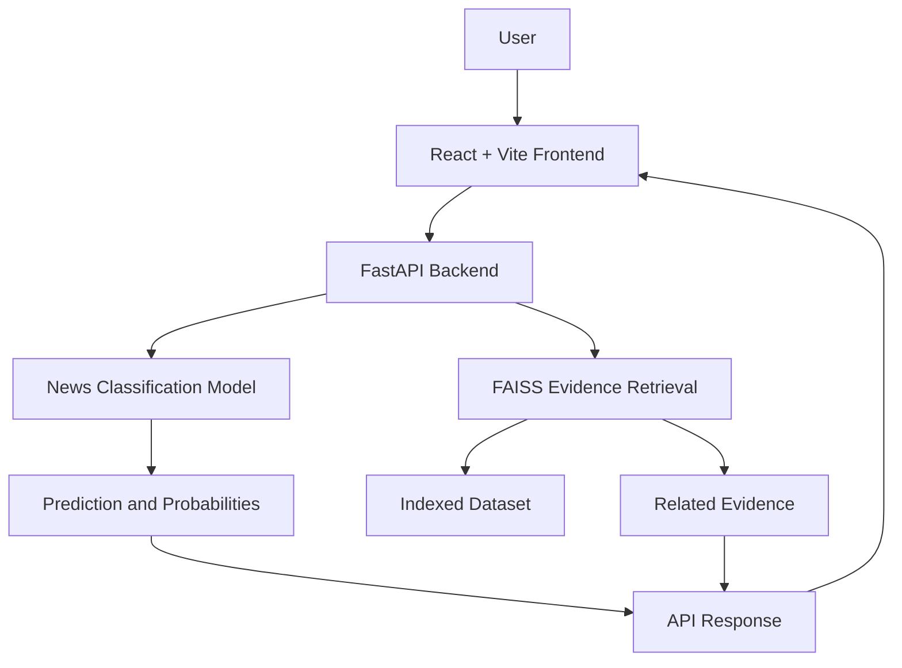

# NewsCred — AI-Powered Fake News Detection

NewsCred is an AI/ML-based web application that classifies news text as **Fake or Real** and retrieves related evidence from an indexed dataset to help users examine the prediction.

The project combines machine learning, semantic search, a FastAPI backend, and a React frontend in one application.

## ✨ Features

- **Fake News Classification:** Predicts whether submitted news text is classified as Fake or Real by the trained model.
- **Evidence Retrieval:** Uses FAISS-based similarity search to retrieve relevant passages from the indexed dataset.
- **Interactive Web Interface:** React and Vite frontend for submitting news text and viewing results.
- **REST API:** FastAPI backend provides endpoints for health checks and news analysis.
- **Evidence Transparency:** Displays retrieved passages separately from the model's classification.
- **Testing:** Includes frontend and backend tests for key application functionality.

## 🛠️ Tech Stack

| Component | Technologies |
|---|---|
| Frontend | React, TypeScript, Vite |
| Backend | Python, FastAPI |
| Machine Learning | Trained news classification model |
| Evidence Retrieval | FAISS, sentence embeddings |
| Testing | Pytest and frontend test tools |

## 🏗️ Architecture



## 📂 Project Structure

```text
news/
├── app/
│   ├── backend/       # FastAPI application
│   └── frontend/      # Existing Streamlit interface, if retained
├── web/               # Integrated React/Vite frontend
├── src/               # Supporting source code, if applicable
├── tests/             # Automated tests
├── data/
│   └── rag/
│       └── index/     # Evidence retrieval index and metadata
├── requirements.txt   # Python dependencies
└── README.md
```

Some directories may contain additional files and subdirectories.

## ⚙️ Prerequisites

Install the following before running the project:

- Python 3.12
- Node.js and npm
- Git
- Visual Studio Code (recommended)

## 🚀 Run Locally on Windows

### 1. Clone the repository

```powershell
git clone https://github.com/puppalaleelaprasanna5-ux/news.git
cd news
```

### 2. Set up the Python environment

```powershell
py -3.12 -m venv .venv
.\.venv\Scripts\Activate.ps1
python -m pip install -r requirements.txt
```

If PowerShell prevents virtual-environment activation, use the Python executable directly from `.venv\Scripts\python.exe` or follow your local PowerShell execution policy guidance.

### 3. Start the FastAPI backend

From the repository root, with the Python environment activated:

```powershell
python -m uvicorn app.backend.main:app --host 127.0.0.1 --port 8000 --reload
```

Backend health endpoint:

`http://127.0.0.1:8000/health`

### 4. Start the React frontend

Open a second terminal in VS Code:

```powershell
npm ci --prefix web
npm run dev --prefix web
```

Open the local URL printed by Vite in the terminal. The frontend development server is configured to communicate with the backend.

### 5. Production frontend

To build the frontend:

```powershell
npm run build --prefix web
```

The FastAPI application is configured to serve the built frontend when the production build is available.

## 🔌 API Endpoints

| Method | Endpoint | Purpose |
|---|---|---|
| GET | `/health` | Reports backend health and available model or retrieval components |
| POST | `/analyze` | Analyzes submitted news text and returns the available prediction and evidence results |

Example request to `/analyze`:

```json
{
  "text": "Paste the news article or claim you want to analyze."
}
```

You can test the API through your local application or a compatible API client. The exact response fields depend on the backend implementation.

## 🧪 Testing

### Backend

Activate the project's Python virtual environment, then run:

```powershell
python -m pytest
```

### Frontend

Run the frontend checks from the repository root:

```powershell
npm test --prefix web
npx tsc --noEmit --project web/tsconfig.json
npm run build --prefix web
```

The test scripts and TypeScript configuration should be present in the repository. If a command differs from the available scripts, follow the corresponding configuration in `web/package.json`.

## 📊 Dataset and Evidence Retrieval

NewsCred uses a dataset and a trained classification model to generate predictions. Its evidence retrieval component searches the indexed dataset for semantically related passages using sentence embeddings and FAISS.

The retrieved passages provide additional context for reviewing a prediction. They do **not** independently establish that a claim is true or false. Prediction probabilities should not be interpreted as verified confidence unless the model has been appropriately calibrated and evaluated.

The application's results depend on the quality, coverage, and contents of the training data and indexed evidence.

## ⚠️ Limitations

- Predictions depend on the trained model and the dataset used.
- Evidence retrieval is limited to the documents available in the index.
- Similarity between a claim and a retrieved passage does not guarantee factual agreement.
- The application should not be treated as a replacement for professional fact-checking or authoritative sources.
- Model performance may vary on news topics or writing styles not well represented in the training data.

## 🔮 Future Improvements

- Expand and improve the indexed evidence dataset.
- Evaluate model performance using suitable classification metrics.
- Calibrate prediction probabilities where appropriate.
- Improve evidence relevance and presentation.
- Add further evaluation and error-analysis tools.
- Deploy the application after the required configuration and validation.

## 👩‍💻 Contributing

Contributions and suggestions are welcome. Open an issue or submit a pull request to propose improvements.

## 📄 License

Add the appropriate license before distributing or reusing this project. No license is implied unless one is included in the repository.

---

**NewsCred** — AI-powered news classification with supporting evidence retrieval.